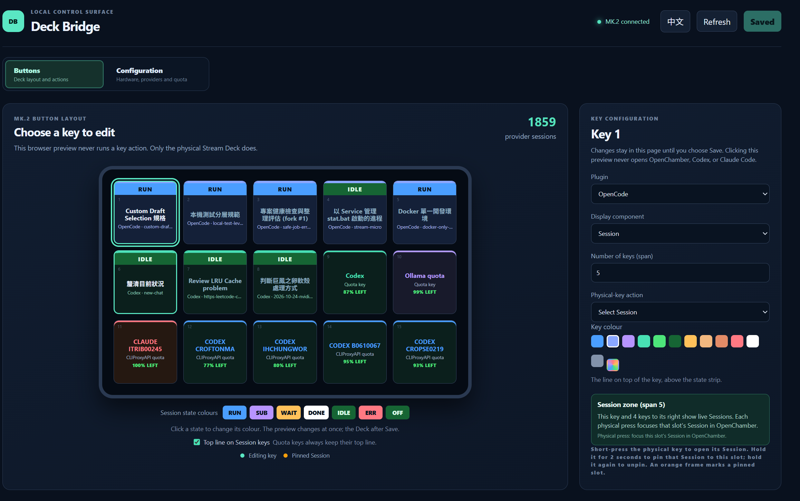

# stream-micro

**Your AI sessions and usage, at a glance on your Stream Deck.**

English | [繁體中文](README.zh-TW.md)

Stream Micro turns an **Elgato Stream Deck MK.2** into a local control surface
for your AI tools. See which sessions are working or waiting for you, jump back
into a session with a key press, and keep an eye on your remaining quota.


Configure your keys in a local Dashboard, with a live preview and support for
**English and Traditional Chinese**.



## What you can do

- **Follow your sessions** — see OpenCode, Codex, Claude Code, and Antigravity
  CLI sessions on your keys, with distinct states for working, waiting, and done.
- **Return to a session** — press its physical key to select or resume it through
  the supported integration.
- **Keep important sessions in place** — hold a Session key for two seconds to
  pin it; hold again to unpin.
- **Watch quota and balances** — display usage windows, reset times, and supported
  API account balances without switching between provider pages.
- **Make the layout yours** — choose session zones, quota accounts, key colours,
  and session-state colours in the Dashboard.
- **Keep it local** — the Dashboard runs on your machine. Stream Micro never
  starts or stops OpenCode for you.

## What you need

- An **Elgato Stream Deck MK.2** (15 keys, 5 × 3). Other Stream Deck models are
  not supported.
- **Windows** for the system tray launcher and CLI session-resume workflows.
  Some session-state detection is also Windows-specific.
- [uv](https://docs.astral.sh/uv/) and [Node.js with npm](https://nodejs.org/)
  for the initial setup. The Python package requires Python 3.10 or newer.
- At least one supported AI tool or quota source. For OpenCode sessions, keep
  your existing OpenCode server running; OpenChamber Desktop is discovered
  automatically when available.

## Get started

### 1. Set up once

Download or clone this repository, then run these commands from its folder in
PowerShell:

```powershell
uv sync --dev
cd frontend
npm ci
npm run build
cd ..
```

### 2. Launch Stream Micro

On Windows, double-click **`start.vbs`** to launch without a console window.
A Stream Deck-shaped icon appears in the system tray; click it to open the
Dashboard. Windows may hide it under **^**.

Alternatively, run with a console:

```powershell
uv run stream-micro serve
```

Open **<http://127.0.0.1:8765>**. The first run creates `bridge.yaml` for your
settings. The launchers do not install dependencies or build the Dashboard, so
complete step 1 first.

### 3. Choose your providers and keys

1. Open **Configuration** to enable the providers and quota sources you use.
   Claude Code's card can install its companion integration for you;
   Antigravity CLI needs its [status-line companion](integrations/antigravity-stream-micro/README.md).
2. Open **Buttons**, select a key, and choose its provider and display component.
   Session zones can span several keys; quota keys can show a selected account.
3. Choose your colours and click **Save** to apply the layout to the Deck.

The browser preview only edits settings: it **never runs a key action**.
Only pressing the physical Stream Deck does that.

## Everyday use

### Session keys

Short-press a Session key to return to that session. Hold it for **two seconds**
to pin it to its slot; an orange frame marks a pinned session. Hold again to
unpin. The default OpenCode layout uses the first five keys for sessions.

The state strip tells you what needs attention:

- **RUN** — working.
- **SUB** — background agents or commands are still working.
- **WAIT** — needs your input or approval.
- **DONE** — finished recently.
- **ERR** — failed.
- **IDLE** — open, with no active turn.
- **OFF** — no live process detected.

State availability depends on the provider and its integration.

### Quota keys

Quota keys can show up to two usage windows, such as **5H** and **7D**, along
with a reset time. By default, the number and bar show what is **left**: green
means plenty, amber means 30% or less, and red means 10% or less. Grey values
are the last readings from a source that is currently unreachable.

Prefer to see consumption? In **Configuration**, change **Quota keys show** to
**What is used**. Supported balance sources show money left instead of a
percentage.

### System tray

Right-click the tray icon to open the Dashboard, restart or stop the Bridge,
enable **登入自動啟動** (start at login), or exit.

- **Stop** keeps the tray icon so you can restart later.
- **Exit** stops the Bridge and releases the Deck.
- Start at login is **off by default**. Disable it before moving the project
  folder or its virtual environment.

The icon is green when the local Bridge responds, yellow while starting or
stopping, and red when stopped or unavailable. A provider outage alone does
not turn it red.

## Portable Windows executable

Download and extract the Windows zip to any folder, then double-click
`StreamMicro.exe`. Settings (`bridge.yaml`), logs (`bridge.log`), and quota state
(`.state/`, created when a plugin first uses it) live beside the executable.
To update, exit Stream Micro from the tray menu (**結束**), extract the new zip
over the existing folder, then relaunch; the zip never contains settings.
After moving the folder, re-enable **登入自動啟動**
and reinstall the Claude companion from the Dashboard if you use it.

To build the executable from source:

```powershell
uv sync --dev --group packaging
uv run --group packaging python build_exe.py
```

The source development workflow using `serve` and `start.vbs` is unchanged.

## Help and further reading

- [Provider setup and advanced configuration](docs/configuration.md) — integration
  requirements, quota sources, YAML examples, and security notes.
- [Troubleshooting](docs/configuration.md#troubleshooting) — startup, ports, logs,
  and unavailable providers.
- [Development](docs/development.md) — local development, hot reload, integration
  contracts, and verification commands.
