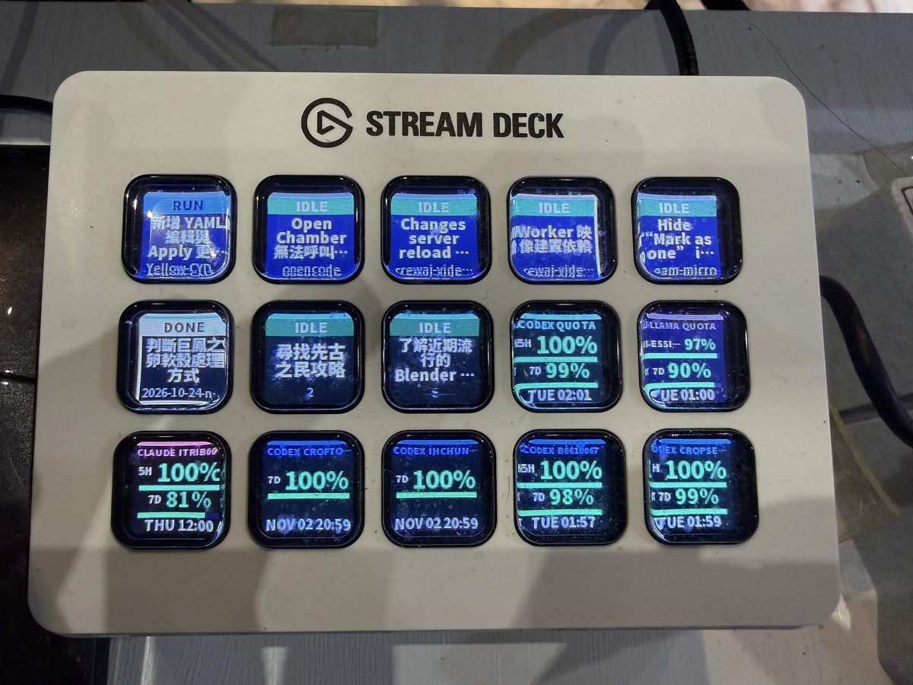

# stream-micro



Local Agent Control Surface for **Elgato Stream Deck MK.2 only** (15 keys,
5 × 3). It discovers a locally running OpenCode Server, renders the first five
Sessions on the first row, and provides a local Dashboard at the same address.

## Run

```powershell
uv sync --dev
cd frontend; npm ci; npm run build; cd ..
uv run stream-micro serve
```

Open `http://127.0.0.1:8765`. The first run writes `bridge.yaml`; it is the
Dashboard's versioned source of truth and does not replace the legacy Ollama
`config.yaml`.

## Development hot reload

Run the Bridge with Python reload enabled:

```powershell
uv run stream-micro serve --reload
```

For Dashboard hot reload, run this in a second terminal and open the URL it
prints (normally `http://127.0.0.1:5173`). API requests are proxied to Bridge.

```powershell
cd frontend; npm run dev
```

OpenCode discovery only checks configured and listening **loopback** endpoints.
The configured fallback endpoint is `http://127.0.0.1:4096`. When OpenChamber
Desktop is running, Bridge automatically prefers its local authenticated proxy
so both surfaces use the same OpenCode Server.

## Session-key behavior

- The first row contains five Session keys.
- Short-pressing a Session key selects its matching Session.
- Holding a Session key for 2 seconds pins that Session to its current slot;
  the key gets an orange frame and stays in place while the other Sessions
  reorder. Hold the key again to unpin it.
- When OpenChamber Desktop is running, Bridge auto-discovers its local control
  server and reads Sessions through its authenticated `/api` proxy. This keeps
  the Deck list and the OpenChamber UI on the same OpenCode Server.

## Plugins

Plugins expose a manifest, configuration validation, a status snapshot, and a
strict allowlist of actions. OpenCode, Codex, and Claude Code can each supply
Session keys. `ollama_quota` is a separate display-only plugin; enable it in
`bridge.yaml` only if you retain the legacy Ollama configuration.

### Claude Code Sessions and quota

Enable `plugins.claude_code` in the Dashboard or `bridge.yaml`. The provider
reads recent Session IDs and titles from the local Claude Code history without
copying credentials. The bundled companion hook supplies live `RUNNING`,
`WAITING`, `COMPLETED`, and `ERROR` state:

```powershell
claude --plugin-dir integrations/claude-code-stream-micro
```

Set `plugins.claude_code.plugin_dir` to that integration folder so a physical
Session-key press resumes the exact Session with the hook enabled. The action
uses Claude Code's official `--resume <session-id>` CLI option and opens it in a
new Windows console. The hook reports to the loopback-only Bridge endpoint and
silently does nothing when Bridge is stopped.

Claude Code exposes Pro/Max subscription usage through its status-line input.
Point `~/.claude/settings.json` at the bundled `scripts/report-quota.mjs` as
shown in the companion integration README. After the first API response, the
Bridge displays the official 5-hour and 7-day usage percentages and reset times
on Claude Code quota keys and in the Dashboard.

### Antigravity CLI Sessions

The Antigravity integration supports the CLI only. On Windows, its default
binary path is `%LOCALAPPDATA%\agy\bin\agy.exe`. Enable
`plugins.antigravity` in the Dashboard or `bridge.yaml`; Stream Micro shows one
latest cached session per workspace. Selecting a Session key opens a new
Windows console and restores that exact selection with
`agy --conversation <id>`.

Setup requires the bundled Antigravity `statusLine` companion script so live
state and quota can reach Bridge. Stream Micro reads or sends no prompts,
history, transcripts, or credentials. If the CLI, cache, or status data is
absent, the provider safely shows as unavailable.

## Verify

```powershell
uv run pytest
uv run ruff check src tests
uv run pyright src tests
cd frontend; npm run build
```
